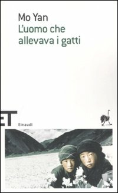

      
Partiamo dal presupposto che sono totalmente ignorante riguardo il contesto storico, ma sono riuscito comunque ad apprezzare i suoi racconti che a questo punto mi hanno reso anche meno ignorante. "Esplosioni" e "Il neonato abbandonato" erano molto interessanti, ho imparato di più sul tema delle nascite in Cina in quegli anni; "Il cane e l'altalena" e il "Il tornado" mi hanno commosso, soprattutto il primo perchè trattava una situazione che chissà quante donne avranno attraversato... L'uomo con la coda in "La colpa" era ripugnante :); "Il fiume inaridito" ha espresso una forte crudeltà, anche se si tratta di un tema trasversale in tutto il libro; "Il vecchio fucile" e "L'uomo che allevava i gatti" mi hanno incantanto con le loro descrizioni, le atmosfere e le luci; "Musica popolare" anche mi ha commosso un po'. Tutti i racconti hanno però in comune la straordinaria descrizione di ciò che accade e delle ambientazioni, delle luci e dei suoni e un senso di completa assenza di speranza riguardo al cambiare mentalità per queste zone della Cina rurale. In un racconto dice qualcosa tipo "potresti portare un attrezzo nuovo di zecca, scintillante qui in campagna e inizierebbe ad arrugginire subito" che è abbastanza emblematico come esempio. In un altro dice che il problema di questi posti riguarda quanto sia radicato e inamovibile il modo di pensare delle persone. Un costante ritorno alla città natale e anche qualcosa di magico permeano tutto il libro.
